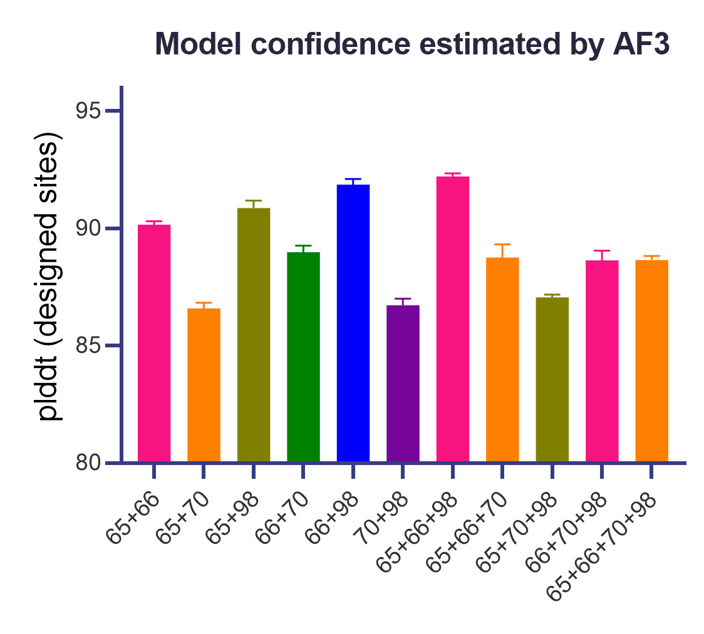
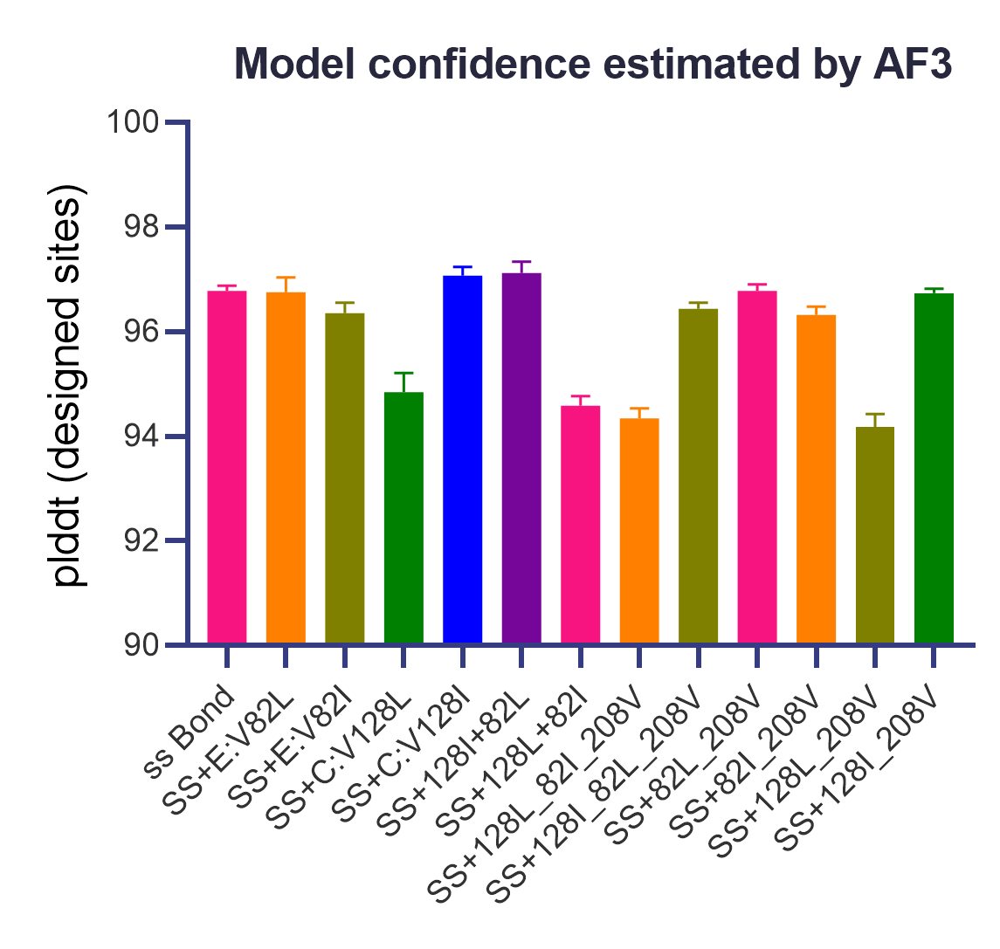
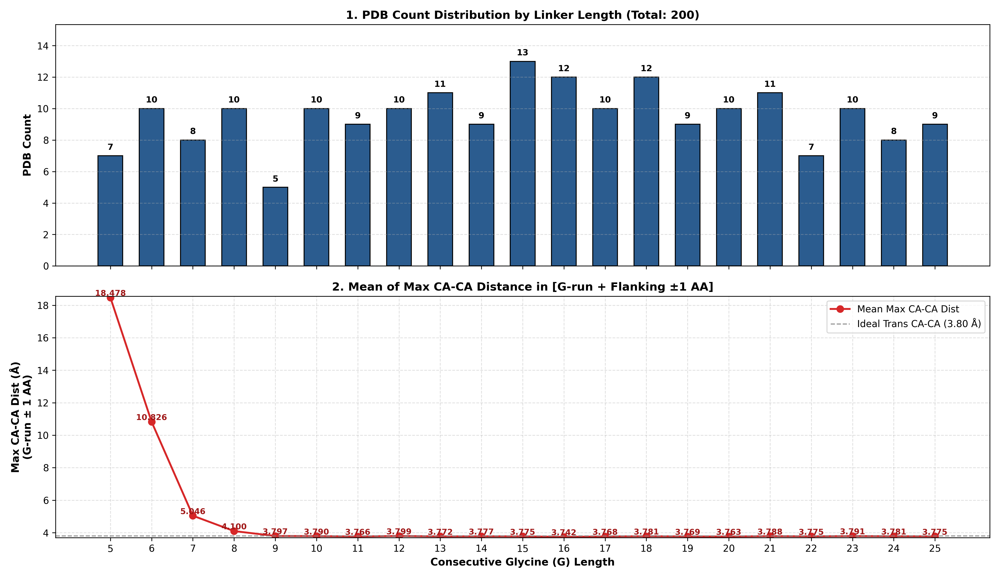
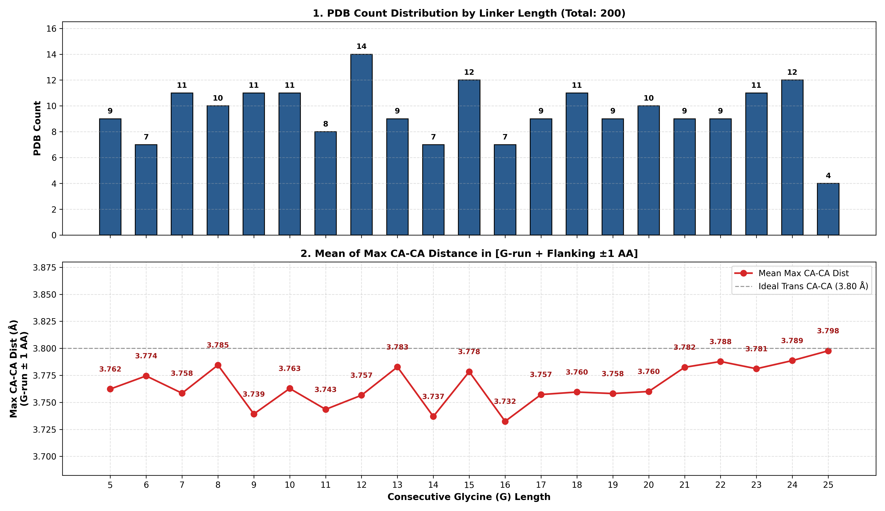

# Computational Design of the HCMV Pentamer

This repository contains the computational design workflow used to stabilize the human cytomegalovirus (HCMV) pentamer through structure-guided optimization of inter-subunit interfaces.

The design strategy was performed in two sequential stages:

1. Optimization of the **gL–UL128–UL130** ternary interface, resulting in **PC-Int1**.
2. Optimization of the **UL128–UL130–UL131A** ternary interface on the PC-Int1 background, resulting in **PC-Int2**.

The computational workflow combines structural modeling, interface residue selection, ProteinMPNN sequence design, and AlphaFold3-based structural evaluation.

---

## 1. Structural Template Preparation

The initial structural template of the HCMV pentamer was derived from the crystal structure **PDB 5VOB**.

Using **Coot**, the amino acid sequence was modified to match the wild-type (WT) sequence used in this study. Missing loop regions were manually modeled to generate a complete structural template for subsequent computational design.

---

## 2. Design of the gL–UL128–UL130 Interface

### 2.1 Designable residues determination

Designable residues were identified according to three criteria:

1. At least one atom of the residue was located within **10 Å** of the interface center (defined as the **NH1 atom of residue R66 in UL130**).
2. The residue participated in the gL–UL128, UL128–UL130, or gL–UL130 interface, defined by at least one interatomic contact within **4 Å**.
3. Residues protected by existing GSK patent (CN111094323B and CN113271968B) claims were excluded from redesign.

The final designable residues submitted to ProteinMPNN were:
```text
gL:      141, 144, 146, 152, 154, 159, 161
UL128:   139, 140, 141, 143, 144, 145
UL130:   65, 66, 70, 97, 98, 99
```

### 2.2 Sequence generatation by design

ProteinMPNN was used to generate **100 candidate sequences** by following command while restricting mutations to the predefined designable positions.
```text
MPNN_PATH=~/softwares/ProteinMPNN-main
PDB_PATH="./WT.pdb"
OUTPUT_DIR="./mpnn_output"

mkdir -p ${OUTPUT_DIR}/inputs
mkdir -p ${OUTPUT_DIR}/outputs

cp ${PDB_PATH} ${OUTPUT_DIR}/inputs/

python ${MPNN_PATH}/helper_scripts/parse_multiple_chains.py \
    --input_path=${OUTPUT_DIR}/inputs \
    --output_path=${OUTPUT_DIR}/parsed_pdbs.jsonl

python ${MPNN_PATH}/helper_scripts/make_fixed_positions_dict.py \
    --input_path=${OUTPUT_DIR}/parsed_pdbs.jsonl \
    --output_path=${OUTPUT_DIR}/fixed_positions.jsonl \
    --chain_list="B C D" \
    --position_list="105 108 110 116 118 123 125, 111 112 113 115 116 117, 21 22 26 53 54 55" \
    --specify_non_fixed
   # pdb A[40-713], B[37-273], C[29-163], D[45-214], E[19-129]
   # --design_res="B:141,144,146,152,154,159,161 C:139,140,141,143,144,145 D:65,66,70,97,98,99" need shift
   # --design_res="B:105,108,110,116,118,123,125 C:111,112,113,115,116,117 D:21,22,26,53,54,55"

python ${MPNN_PATH}/protein_mpnn_run.py \
    --jsonl_path=${OUTPUT_DIR}/parsed_pdbs.jsonl \
    --fixed_positions_jsonl=${OUTPUT_DIR}/fixed_positions.jsonl \
    --out_folder=${OUTPUT_DIR}/outputs \
    --num_seq_per_target=100 \
    --sampling_temp="0.2" \
    --seed=37 \
    --batch_size=1
```

After running the command above, the results are as folows.
Candidate substitutions were subsequently filtered according to two criteria:
1. The mutation occurred in **top 2** or more than **25%** of the generated sequences at that position.
2. Structural inspection indicated the introduction of additional favorable interfacial interactions, including hydrogen bonds, salt bridges, or improved hydrophobic packing.

| Chain | Num(MPNN) | PDB ResNum | WT AA | Top Designed Amino Acids (Frequency) | Mutations and effects |
|--------|--------|--------|--------|--------|--------|
| B | 116 | 152 | Y | Y: 73.0%, T: 18.0%, A: 4.0%, W: 3.0% | Y152T: poor packing |
| B | 118 | 154 | C | C: 71.0%, V: 29.0% | C154V: loss of disulfide bond |
| B | 123 | 159 | C | C: 71.0%, A: 28.0%, S: 1.0% | C162A: loss of disulfide bond |
| B | 125 | 161 | G | G: 68.0%, S: 32.0% | G164S: disrupting local hydrophobic pocket |
| C | 111 | 139 | K | P: 89.0%, R: 10.0%, K: 1.0% | K139P: loss of H-bond; K139R: No significant effect |
| C | 112 | 140 | I | P: 100.0% | I140P: No significant effect |
| C | 113 | 141 | T | G: 53.0%, R: 25.0%, S: 14.0%, K: 3.0% | T141G: loss of H-bond; T141R: clash |
| C | 115 | 143 | I | I: 36.0%, V: 26.0%, F: 20.0%, L: 15.0% | I143V: No significant effect  |
| C | 116 | 144 | V | V: 97.0%, Y: 2.0%, L: 1.0% | V144Y: clash |
| D | 21 | 65 | P | E: 77.0%, P: 20.0%, R: 2.0%, K: 1.0%| **P65E: new salt bridge** |
| D | 22 | 66 | R | R: 91.0%, F: 4.0%, V: 4.0%, M: 1.0% | **R66F: extended hydrophobic pocket** |
| D | 26 | 70 | Q | D: 62.0%, W: 26.0%, R: 7.0%, E: 3.0% | Q70D: alternative interaction; **Q70W: extended hydrophobic pocket** |
| D | 54 | 98 | T | T: 55.0%, I: 32.0%, A: 7.0%, V: 6.0% | **T98I: extended hydrophobic pocket** |
| D | 55 | 99 | L | L: 95.0%, V: 5.0% | L99V: No significant effect |

The following substitutions were retained:

```text
UL130:P65E; UL130:R66F; UL130:Q70W; UL130:T98I
```

### 2.3 AlphaFold3 screening

All two-, three-, and four-mutation combinations of the retained substitutions were subsequently modeled using **AlphaFold3**.



Candidate models were ranked according to:

1. The average pLDDT of the candidate mutation sites.
2. For tied candidates, the backbone RMSD of the designed residues relative to the WT structure was used as a secondary criterion.

The highest-ranked design **UL130:P65E+R66F+T98I** was designated **PC-Int1** and selected for subsequent experimental validation.

---

## 3. Design of the UL128–UL130–UL131A Interface

To further improve pentamer stability, a second computational design round was performed at the **UL128–UL130–UL131A ternary interface** on **PC-Int1** background.


### 3.1 Designable residues determination

The center of the UL128–UL130–UL131A interface was defined as the **Cβ atom of residue D210 in chain D (UL130)** of the 5VOB structure.

Designable residues were selected using the same 3 criteria as described above

The final designable residues submitted to ProteinMPNN were:

```text
UL128:
86, 100, 123, 124, 125, 126, 127, 128, 129, 130

UL130:
161, 163, 164, 165, 196, 206, 207, 208, 209, 210, 211, 212, 213

UL131A:
37, 82, 83, 85, 89, 113, 118
```

### 3.2 Sequence generatation by design

ProteinMPNN was used to generate **100 candidate sequences** while restricting mutations to the predefined designable positions.

```text
MPNN_PATH=~/softwares/ProteinMPNN-main
PDB_PATH="./PC-Int1.pdb"
OUTPUT_DIR="./mpnn_output"

mkdir -p ${OUTPUT_DIR}/inputs
mkdir -p ${OUTPUT_DIR}/outputs

cp ${PDB_PATH} ${OUTPUT_DIR}/inputs/

python ${MPNN_PATH}/helper_scripts/parse_multiple_chains.py \
    --input_path=${OUTPUT_DIR}/inputs \
    --output_path=${OUTPUT_DIR}/parsed_pdbs.jsonl

python ${MPNN_PATH}/helper_scripts/make_fixed_positions_dict.py \
    --input_path=${OUTPUT_DIR}/parsed_pdbs.jsonl \
    --output_path=${OUTPUT_DIR}/fixed_positions.jsonl \
    --chain_list="C D E" \
    --position_list="58 72 95 96 97 98 99 100 101 102, 117 119 120 121 152 162 163 164 165 166 167 168 169, 19 64 65 67 71 95 100" \
    --specify_non_fixed
   # pdb A[40-713], B[37-273], C[29-163], D[45-214], E[19-129]
   # --design_res="C:86, 100, 123, 124, 125, 126, 127, 128, 129, 130 D:161, 163, 164, 165, 196, 206, 207, 208, 209, 210, 211, 212, 213 E:37, 82, 83, 85, 89, 113, 118" need shift
   # --design_res="C:58, 72, 95, 96, 97, 98, 99, 100, 101, 102 D:117, 119, 120, 121, 152, 162, 163, 164, 165, 166, 167, 168, 169 E:19, 64, 65, 67, 71, 95, 100"

python ${MPNN_PATH}/protein_mpnn_run.py \
    --jsonl_path=${OUTPUT_DIR}/parsed_pdbs.jsonl \
    --fixed_positions_jsonl=${OUTPUT_DIR}/fixed_positions.jsonl \
    --out_folder=${OUTPUT_DIR}/outputs \
    --num_seq_per_target=100 \
    --sampling_temp="0.2" \
    --seed=5 \
    --batch_size=1
```

Candidate substitutions were filtered using the same 2 criteria described above.

| Chain | Num(MPNN) | PDB ResNum | WT AA | Top Designed Amino Acids (Frequency) | Mutations and effects |
|--------|--------|--------|--------|--------|--------|
| C | 58 | 86 | R | R: 90.0%, K: 10.0% | R86K: No significant effect |
| C | 96 | 124 | A | A: 98.0%, S: 2.0% | A124S: disrupting local hydrophobic pocket |
| C | 97 | 125 | A | R: 57.0%, N: 21.0%, Y: 15.0%, S: 5.0% | A125R/N: No significant effect |
| C | 98 | 126 | G | R: 55.0%, K: 34.0%, E: 4.0%, T: 4.0% | G126R/K: No significant effect |
| C | 99 | 127 | S | E: 71.0%, T: 14.0%, S: 12.0%, K: 3.0% | S127E/T: No significant effect |
| C | 100 | 128 | V | L: 72.0%, I: 23.0%, V: 4.0%, M: 1.0% | **V128L/I: extended hydrophobic pocket** |
| C | 101 | 129 | P | P: 69.0%, D: 22.0%, E: 7.0%, N: 2.0% | P129D: No significant effect |
| C | 102 | 130 | Y | Y: 94.0%, G: 5.0%, C: 1.0% | Y130G: No significant effect; **Y130C: establishing disulfide bond** |
| D | 119 | 163 | V | A: 53.0%, V: 46.0%, C: 1.0% | V163A: poor packing; **V163C: establishing disulfide bond** |
| D | 120 | 164 | N | K: 91.0%, R: 9.0% | N164K/R: No significant effect |
| D | 152 | 196 | F | L: 58.0%, F: 40.0%, I: 2.0% | F196L: poor packing |
| D | 162 | 206 | F | L: 91.0%, V: 9.0% | F206L/V: poor packing |
| D | 164 | 208 | T | V: 83.0%, T: 17.0% | **T208V: extended hydrophobic pocket**  |
| D | 165 | 209 | H | N: 86.0%, L: 7.0%, R: 5.0%, H: 2.0% | H209N/L: poor packing |
| D | 168 | 212 | L | L: 97.0%, I: 3.0% | L212I: No significant effect |
| D | 169 | 213 | I | I: 68.0%, V: 24.0%, L: 8.0% | I213V: poor packing |
| E | 19 | 37 | W | W: 97.0%, F: 3.0% | W37F: poor packing |
| E | 64 | 82 | V | I: 45.0%, P: 41.0%, L: 11.0%, V: 3.0% | **V82I/P/L: extended hydrophobic pocket** |
| E | 67 | 85 | V | V: 82.0%, L: 17.0%, T: 1.0% | **V85L: extended hydrophobic pocket** |
| E | 71 | 89 | I | I: 99.0%, V: 1.0% | I89V: poor packing |
| E | 95 | 113 | L | I: 96.0%, L: 4.0% | L113I: No significant effect |
| E | 100 | 118 | R | R: 90.0%, S: 6.0%, Q: 2.0%, I: 1.0% | R118S: poor packing |

Although the `UL128:Y130C` and `UL130:V163C` substitutions exhibit low sampling frequencies in ProteinMPNN sequence generation, spatial geometry analysis indicates that this residue pair forms a stabilizing inter-subunit disulfide bond across the UL128–UL130 interface. This covalent tether is designed to enhance the overall conformational stability and assembly rigidity of the pentameric complex; therefore, this pair was prioritized and retained for downstream experimental evaluation.

The frequently predicted candidate `UL131A:V82P` disrupts the canonical $^{81}\text{NVT}^{83}$ ($N\text{-}X\text{-S/T}$, $X \neq \text{Pro}$) consensus motif, abolishing essential $N$-linked glycosylation at the Asn81 site. To maintain native post-translational modifications (PTMs) and structural fidelity while retaining favorable hydrophobic packing, We introduced the third-order `V82L` mutation as a candidate mutation for comparative evaluation.

Finally, the following substitutions were retained:

```text
UL128:V128L/I; UL128:Y130C; UL130:V163C; UL130:T208V; UL131A:V82I/L; UL131A:V85L
```

### 3.3 AlphaFold3 screening

All combinations of the retained mutations were subsequently modeled using **AlphaFold3** together with the three stabilizing mutations from PC-Int1.



The highest-ranked design contained four additional substitutions (on the PC-Int1 background):

```text
UL128:V128I; UL128:Y130C; UL130:V163C; UL131A:V82L
```

This design was designated **PC-Int2** and selected for subsequent experimental characterization.

---

## 4. Linker design
### 4.1 Linker backbone generation
To generate geometrically feasible fusion architectures between adjacent protein domains, de novo backbone diffusion was conducted using RFdiffusion with the Contigmap framework. 

For UL128_UL130_linker:
```text
~/softwares//RFdiffusion/scripts/run_inference.py diffuser.T=15 inference.cautious=False 'contigmap.contigs=[C29-163/5-25/D45-214]' inference.output_prefix=test_outputs/UL128_UL130_linker inference.input_pdb=ULs_pdbs.pdb inference.num_designs=200
```
For UL130_UL131A_linker:
```text
~/softwares//RFdiffusion/scripts/run_inference.py diffuser.T=15 inference.cautious=False 'contigmap.contigs=[D45-214/5-25/E19-129]' inference.output_prefix=test_outputs/UL130_UL131A_linker inference.input_pdb=ULs_pdbs.pdb inference.num_designs=200
```
### 4.2 Linker length seletion
In Silico Structural Assessment MetricsGenerated backbones were systematically evaluated across two key structural criteria:

1. Linker Length Sampling and Yield Distribution

2. Peptide Bond Geometry: the maximum adjacent $C_\alpha - C_\alpha$ Euclidean distance was measured across the entire flexible region (including immediate flanking residues $\pm 1$ aa).

For linker between UL128 and UL130:


For linker between UL130 and UL131A:


The finalized single-chain fusion construct was engineered as follows:

* **UL128 (residues 29–163)** fused to **UL130 (residues 45–214)** via a 15-residue flexible linker: `(GGGGS)3`
* **UL130 (residues 45–214)** fused to **UL131A (residues 19–129)** via a 12-residue flexible linker: `(GGGS)3`

The resulting full-length single-chain construct was designated **PC-Fuse** and subjected to downstream structural validation and experimental characterization.

## 5. Software

The computational design workflow used the following software:

| Software | Purpose |
|---|---|
| [Coot](https://www2.mrc-lmb.cam.ac.uk/personal/pemsley/coot/) | Structural model preparation and manual loop modeling |
| [ProteinMPNN](https://github.com/dauparas/ProteinMPNN) | Protein sequence design |
| [AlphaFold3](https://github.com/google-deepmind/alphafold3) | Structural prediction and candidate evaluation |
| [RFDiffusion](https://github.com/RosettaCommons/RFdiffusion) | Linker backbone generation |

---

## 6. License

Please see the `LICENSE` file for information regarding the use and redistribution of the code and data contained in this repository.
